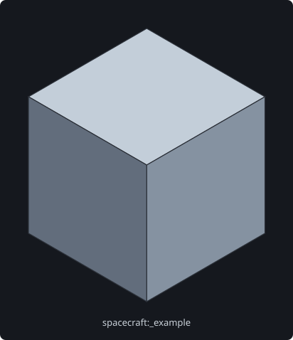

# block一覧

`spacecraft` に **ブロック**を追加したときに更新する一覧です。**ブロックはすべて 3D モデルで登録します**。
共通の手順・命名規則は [`一覧の使い方.md`](../一覧の使い方.md) にあります。

## 使い方（ブロックを 1 つ追加したら）

1. [`_template.md`](_template.md) を `<id>.md` にコピーします（例 `moon_rock.md`）。
2. `<...>` をすべて埋め、**「使い方」をすべて書きます**。
3. **`models/<id>.json`** と **`blockstates/<id>.json`** を作ります（`_example_model.json` / `_example_blockstate.json` が見本です）。
4. その JSON の `elements`・各面の `uv` から組み立てた **3D 画像**を `images/<id>_3d.svg` に置きます（`catalog.py render` で自動生成）。
5. md から JSON へリンクし、画像コメントを外して表示されるようにします。
6. 下の表に 1 行追加します。
7. **ビルドは不要**です。この一覧の変更は CI にも jar にも影響しません。

> `ここに追加` はユーザーさんが作ったプレースホルダです。残してください。

## 登録ブロック

| id | 名前 | md | 状態 |
| --- | --- | --- | --- |
| — | — | — | まだ登録されていません（該当要素は未実装のため） |

## 画像の置き場所

```
block一覧/
├── README.md                  ← このファイル
├── _template.md               ← コピーして使う雛形
├── _example_model.json        ← モデル JSON の見本
├── _example_blockstate.json   ← ブロックステート JSON の見本
├── ここに追加                  ← プレースホルダ（残す）
├── <id>.md                    ← ブロックごとの説明
├── models/<id>.json
├── blockstates/<id>.json
└── images/<id>_3d.svg
```

## 3D 画像の見本

[`_example_model.json`](_example_model.json) の `elements` から `python3 tools/catalog.py render block一覧 x --example` で組み立てた画像です（外部ライブラリ不要の SVG）。



## 3D 画像について

「json などを使用し組み立てた 3D 画像」とは、`models/<id>.json` の `elements`（`from` / `to`）と各面の `texture` / `uv` を元に、`tools/model3d.py` が等角投影で描き起こした画像のことです。**元データの JSON を必ず一緒に残し、md からリンクしてください**。画像だけを置かないでください。

## 注意

- 実装していないブロックの md は作らないでください。
- この `models/` / `blockstates/` は**説明用の写し**です。実際にゲームへ読み込ませる JSON は `src/main/resources/assets/spacecraft/models/` と `.../blockstates/` に置きます。
