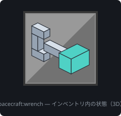

# レンチ（`spacecraft:wrench`）

> `catalog.py new` で作成し、`itemart.py` の生成画像を埋め込んだファイルです。
> 共通手順は [`一覧の使い方.md`](../一覧の使い方.md) を参照。

## 基本情報

| 項目 | 値 |
| --- | --- |
| 登録 id | `spacecraft:wrench` |
| 日本語名 | レンチ |
| 英語名 | Wrench |
| 追加バージョン | 1.0.0 |
| 実装クラス | `SpaceCraft.java`（登録）/ `item/WrenchItem.java`（挙動） |
| 登録先 | `DeferredRegister<Item>` + `DeferredRegister<CreativeModeTab>` |
| クリエイティブタブ | **宇宙クラフト**（`spacecraft:spacecraft`） |
| モデル | `item/handheld` |
| 状態 | **実装済み** |
| 最終更新 | 2026-11-24 |

## 画像

| 種類 | ファイル | 状態 |
| --- | --- | --- |
| **インベントリ内の状態** | `images/wrench_inventory.svg` | 配置済み |
| **手に持った状態** | `images/wrench_held.svg` | 配置済み |




> 2 枚とも `python3 tools/itemart.py wrench` が生成した **実テクスチャ由来の模式図**です。
> `gradle runClient` でゲーム内スクリーンショットが撮れたら、`images/wrench_inventory.png` / `wrench_held.png` を置き、下の 2 つのリンクと上の表の拡張子を `.svg` → `.png` に書き換えてください（`catalog.py check` はどちらの拡張子も受理します）。

## モデル・リソース

| 用途 | パス |
| --- | --- |
| アイテムモデル | [`../src/main/resources/assets/spacecraft/models/item/wrench.json`](../src/main/resources/assets/spacecraft/models/item/wrench.json) |
| テクスチャ（16×16 RGBA） | [`../src/main/resources/assets/spacecraft/textures/item/wrench.png`](../src/main/resources/assets/spacecraft/textures/item/wrench.png) |
| 英語名 | `assets/spacecraft/lang/en_us.json` |
| 日本語名 | `assets/spacecraft/lang/ja_jp.json` |
| 説明用の写し | `models/wrench.json`（任意・未作成） |

## 使い方（すべて）

### 入手方法

- **クリエイティブ**: タブ「**宇宙クラフト**」の先頭に 1 個だけ並びます。タブのアイコンもこのレンチです。
- **サバイバル**: 現時点ではレシピ・ドロップ・取引・戦利品テーブルは**未設定**です。入手するにはコマンドを使います。
- **コマンド**: `/give @s spacecraft:wrench`

### 基本的な操作

- **ブロックに右クリック** → そのブロックの `BlockState` を **時計回りに 90 度回転**します（`Rotation.CLOCKWISE_90`）。
  - 実装は `WrenchItem#useOn`。サーバー側のみ `level.setBlock(pos, rotated, Block.UPDATE_ALL)` を実行し、クライアントへ同期されます。
  - 成功時は `InteractionResult.sidedSuccess` を返します（腕の振り・音の判定に使われます）。
- **向きを持たないブロック**（石・土など、回転しても状態が変わらないもの）→ `InteractionResult.PASS`。**レンチによる回転は起きません**。右クリックはバニラ側へ委ねられるため、かまどなどの GUI は通常どおり開きます。
- **左クリック**: 通常のアイテムとしての挙動のみ（専用処理なし）。
- **エンティティに対して使ったとき**: 専用処理なし（`useOn` はブロック対象のみ）。
- **空中で右クリック**: 専用処理なし。
- **使用時間・クールダウン・消費**: すべて無し。耐久値も無いので何度でも使えます。

### インベントリ内での扱い

- 最大スタック数: **1**（`new Item.Properties().stacksTo(1)`）
- 耐久値: **無し**（`Item` の既定）
- 修理: 不可（耐久が無いため）
- エンチャント: 不可
- NBT / Capability / Data Component: 専用データは保持しません
- 捨てた / 燃やした / 爆発したとき: バニラのアイテムと同じ挙動
- ホッパー・ディスペンサー: バニラのアイテムとして移動・発射されます（右クリック効果は発動しません）

### 手に持った状態の挙動

- モデルは `item/handheld`。一人称・三人称ともに道具としての持ち方になります（`wrench_held.svg` と対応）。
- オフハンドにも持てますが、`useOn` は使用中のハンドに依存せず発動します。
- 持ち替え時の専用アニメーションはありません。

### レシピ

| 種類 | 材料 | 結果 |
| --- | --- | --- |
| — | — | **現時点では未実装**（コマンドで入手） |

> 追加する場合: `src/main/resources/data/spacecraft/recipe/wrench.json` を作り、この表に追記してください。

### コマンド

```mcfunction
/give @s spacecraft:wrench
/clear @s spacecraft:wrench
# 回転の確認用（例: 向きを持つブロックを置く）
/setblock ~ ~ ~ minecraft:oak_stairs[facing=east,half=bottom,shape=straight,waterlogged=false]
```

### 設定・コンフィグ

- 現時点で設定項目は**ありません**（回転方向・可否・対象ブロックの制限はすべてコード側の固定挙動）。
- 難易度による差: なし。

### 他要素との関係

- クリエイティブタブ「宇宙クラフト」のアイコン兼最初の登録アイテムです。
- 今後追加するブロック・装備・UI・エンティティの設定／分解に使う想定です（対応先が出来たら各一覧へリンクを追加）。
- ブロックタグ・アイテムタグ: 未設定。

### 制限・注意

- 回転は **`BlockState#rotate` が状態を変える場合のみ**発動します。回転非対応のブロックには何も起きません。
- ディメンション・ゲームモード・権限による制限はありません。
- 現状はテクスチャ・モデル・言語ファイルのみで、レシピと戦利品テーブルは未実装です。
- 画像 2 枚は実テクスチャから生成した**模式図**であり、ゲーム内スクリーンショットではありません。

### 既知の問題

- ゲーム内スクリーンショットが未取得のため、一覧の画像は模式図です（実装自体は完了しています）。
- サバイバルでの入手手段がまだ無いため、`/give` が必要です。

### トラブルシュート

| 症状 | 原因 | 対処 |
| --- | --- | --- |
| 右クリックしても何も起きない | 向きを持たないブロック | `oak_stairs` や `furnace` など `facing` を持つブロックで試す |
| 紫黒のチェック柄になる | テクスチャ／モデルのパス不一致 | `textures/item/wrench.png` と `models/item/wrench.json` の `layer0` を確認 |
| タブに出ない | 登録失敗 | `latest.log` の `Registry` エラーを確認し、`ITEMS.register(bus)` が呼ばれているか見る |
| 名前が `item.spacecraft.wrench` と出る | 言語ファイル未読込 | `assets/spacecraft/lang/ja_jp.json` / `en_us.json` の配置を確認 |

## 関連ファイル

- `src/main/java/io/github/python121212/spacecraft/SpaceCraft.java`
- `src/main/java/io/github/python121212/spacecraft/item/WrenchItem.java`
- `src/main/resources/assets/spacecraft/models/item/wrench.json`
- `src/main/resources/assets/spacecraft/textures/item/wrench.png`
- `src/main/resources/assets/spacecraft/lang/{en_us,ja_jp}.json`
- 生成ツール: [`../tools/itemart.py`](../tools/itemart.py)
- 一覧: [`README.md`](README.md)

## 追加時チェックリスト

- [x] `<...>` をすべて埋めた
- [x] `images/wrench_inventory.svg` を置いた
- [x] `images/wrench_held.svg` を置いた
- [x] md の画像コメントを外した
- [x] 「使い方」をすべて書いた
- [x] [`README.md`](README.md) の表に 1 行追加した
- [x] `python3 tools/catalog.py check` が通った
- [x] ビルドは GitHub Actions でのみ確認（一覧の更新自体にビルドは不要）
