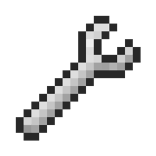
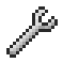
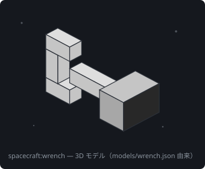
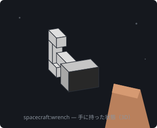

# レンチ（`spacecraft:wrench`）

> `catalog.py new` で作成し、**`画像/` の見本テクスチャ由来の 3D 画像**を埋め込んだファイルです。
> 共通手順は [`一覧の使い方.md`](../一覧の使い方.md) を参照。

## 基本情報

| 項目 | 値 |
| --- | --- |
| 登録 id | `spacecraft:wrench` |
| 日本語名 | レンチ |
| 英語名 | Wrench |
| 追加バージョン | 1.0.0 |
| 実装クラス | `SpaceCraft.java`（登録）/ `item/WrenchItem.java`（挙動） |
| 登録先 | `DeferredRegister<Item>` + `DeferredRegister<CreativeModeTab>` |
| クリエイティブタブ | **宇宙クラフト**（`spacecraft:spacecraft`） |
| 見た目 | **3D モデル**（`block/block` 継承 + `elements` 5 個の直方体） |
| テクスチャ source | [`画像/IMG_809df39f-4a58-433f-b6f5-0b58e51e80d2.png`](../画像/IMG_809df39f-4a58-433f-b6f5-0b58e51e80d2.png) |
| 実テクスチャ | 64×64 RGBA（見本をエリア平均で縮小・白背景は段階透過） |
| 状態 | **実装済み** |
| 最終更新 | 2026-11-25 |

## 元テクスチャ（ユーザー指定の見本）

[`画像/`](../画像/README.md) に置かれた見本です。256×256 のインデックスカラー PNG で、**16×16 のドット絵を 16 倍に拡大**したものです。白背景・黒アウトライン・銀のグラデーション、斜めの柄と U 字の開口が特徴です。



### ゲームに読み込まれる実テクスチャ

`python3 tools/itemart.py wrench` が見本を **64×64 へエリア平均**で落とし、白背景を段階的に透過したものです。1 セル 1 色に量子化していた頃より銀の階調が滑らかで、輪郭も白くにじみません。



## 画像（すべて 3D）

3 枚とも [`models/wrench.json`](models/wrench.json) の `elements` と、実テクスチャの `faces.uv` から
[`tools/model3d.py`](../tools/model3d.py) が等角投影で組み立てたものです。視点・背景だけが違います。
**面の色はすべて見本画像の実ピクセル色**なので、テクスチャと 3D 画像の配色は一致します。

| 種類 | ファイル | 状態 |
| --- | --- | --- |
| **3D モデル全体図** | `images/wrench_3d.svg` | 配置済み |
| **インベントリ内の状態**（3D） | `images/wrench_inventory.svg` | 配置済み |
| **手に持った状態**（3D） | `images/wrench_held.svg` | 配置済み |






> **2D のスプライト画像には戻さないでください。** ゲーム内で見た目を確認したいときは `gradle runClient` を使います（画像の差し替えは不要）。

## モデル・リソース

| 用途 | パス |
| --- | --- |
| **見本テクスチャ（source）** | [`../画像/IMG_809df39f-4a58-433f-b6f5-0b58e51e80d2.png`](../画像/IMG_809df39f-4a58-433f-b6f5-0b58e51e80d2.png) |
| ゲームに読み込まれる 3D モデル | [`../src/main/resources/assets/spacecraft/models/item/wrench.json`](../src/main/resources/assets/spacecraft/models/item/wrench.json) |
| **説明用の写し（3D 画像の元データ）** | [`models/wrench.json`](models/wrench.json) |
| 64×64 実テクスチャ | [`../src/main/resources/assets/spacecraft/textures/item/wrench.png`](../src/main/resources/assets/spacecraft/textures/item/wrench.png) |
| 英語名 / 日本語名 | `assets/spacecraft/lang/{en_us,ja_jp}.json` |
| 生成ツール | [`../tools/itemart.py`](../tools/itemart.py) / [`../tools/model3d.py`](../tools/model3d.py) |

### 3D モデルの構成

`parent: block/block` を継承し、横に寝かせたレンチを **5 つの直方体**で表現しています。

| element | `from` → `to` | 役割 |
| --- | --- | --- |
| 柄 | `[4,7,7]` → `[12,9,9]` | 中央の金属棒 |
| グリップ | `[11,6,5]` → `[15,10,11]` | 右端の握り。+x 端面だけ黒アウトライン |
| 開口・上あご | `[0,10,7]` → `[4,12,9]` | U 字の上 |
| 開口・下あご | `[0,4,7]` → `[4,6,9]` | U 字の下 |
| 開口・背 | `[0,6,7]` → `[2,10,9]` | U 字の左壁 |

各面の `faces.uv` は **64×64 実テクスチャ上の 1 テクセル**を指します。見本画像から抽出した実色だけを使い、上面 → 側面 → 別階調 → 下面 → 輪郭の順で明るくなるよう選んでいます。

| 役割 | uv | 色 | 見本での意味 |
| --- | --- | --- | --- |
| 上面 | `(14,46,15,47)` | `#dedede` | 最も明るい銀 |
| 側面 | `(14,49,15,50)` | `#c5c5c5` | 銀の中間色 |
| グリップの別階調 | `(12,51,13,52)` | `#a7a7a7` | 中間の別階調 |
| 下面 | `(49,27,50,28)` | `#9f9f9f` | 影になった銀 |
| アウトライン / グリップ端面 | `(7,50,8,51)` | `#282828` | 黒い輪郭 |

> 64×64 へエリア平均すると極小のハイライト点が消えるため、面の色は**テクスチャ全体を平均せず 1 テクセルで点を拾って**います。テクスチャ側は滑らかな階調を保ったままです。

`display` に `gui` / `firstperson_*` / `thirdperson_*` / `ground` を指定しているため、
インベントリ内・手持ち・三人称・地面に落ちた状態のすべてで立体として表示されます。

## 使い方（すべて）

### 入手方法

- **クリエイティブ**: タブ「**宇宙クラフト**」の先頭に 1 個だけ並びます。タブのアイコンもこのレンチです。
- **サバイバル**: 現時点ではレシピ・ドロップ・取引・戦利品テーブルは**未設定**です。入手するにはコマンドを使います。
- **コマンド**: `/give @s spacecraft:wrench`

### 基本的な操作

- **ブロックに右クリック** → そのブロックの `BlockState` を **時計回りに 90 度回転**します（`Rotation.CLOCKWISE_90`）。
  - 実装は `WrenchItem#useOn`。サーバー側のみ `level.setBlock(pos, rotated, Block.UPDATE_ALL)` を実行し、クライアントへ同期されます。
  - 成功時は `InteractionResult.sidedSuccess` を返します（腕の振り・音の判定に使われます）。
- **向きを持たないブロック**（石・土など、回転しても状態が変わらないもの）→ `InteractionResult.PASS`。**レンチによる回転は起きません**。右クリックはバニラ側へ委ねられるため、かまどなどの GUI は通常どおり開きます。
- **左クリック**: 通常のアイテムとしての挙動のみ（専用処理なし）。
- **エンティティに対して使ったとき**: 専用処理なし（`useOn` はブロック対象のみ）。
- **空中で右クリック**: 専用処理なし。
- **使用時間・クールダウン・消費**: すべて無し。耐久値も無いので何度でも使えます。

### インベントリ内での扱い

- 最大スタック数: **1**（`new Item.Properties().stacksTo(1)`）
- 耐久値: **無し**（`Item` の既定）
- 修理: 不可（耐久が無いため）
- エンチャント: 不可
- NBT / Capability / Data Component: 専用データは保持しません
- 捨てた / 燃やした / 爆発したとき: バニラのアイテムと同じ挙動
- ホッパー・ディスペンサー: バニラのアイテムとして移動・発射されます（右クリック効果は発動しません）
- スロット上では `display.gui` の回転が効き、**斜めから見た立体**として表示されます（`wrench_inventory.svg` と対応）。

### 手に持った状態の挙動

- `display.firstperson_righthand` / `thirdperson_righthand`（および左手版）で道具としての持ち方になります（`wrench_held.svg` と対応）。
- 3D モデルなので、視点を変えると柄・開口・グリップの厚みが見えます。
- オフハンドにも持てますが、`useOn` は使用中のハンドに依存せず発動します。
- 持ち替え時の専用アニメーションはありません。

### レシピ

| 種類 | 材料 | 結果 |
| --- | --- | --- |
| — | — | **現時点では未実装**（コマンドで入手） |

> 追加する場合: `src/main/resources/data/spacecraft/recipe/wrench.json` を作り、この表に追記してください。

### コマンド

```mcfunction
/give @s spacecraft:wrench
/clear @s spacecraft:wrench
# 回転の確認用（例: 向きを持つブロックを置く）
/setblock ~ ~ ~ minecraft:oak_stairs[facing=east,half=bottom,shape=straight,waterlogged=false]
```

### 設定・コンフィグ

- 現時点で設定項目は**ありません**（回転方向・可否・対象ブロックの制限はすべてコード側の固定挙動）。
- 難易度による差: なし。

### 他要素との関係

- クリエイティブタブ「宇宙クラフト」のアイコン兼最初の登録アイテムです。
- 今後追加するブロック・装備・エンティティの設定／分解に使う想定です（対応先が出来たら各一覧へリンクを追加）。
- **今後追加する要素もすべて 3D** で、テクスチャは [`画像/`](../画像/README.md) の見本を source にします。
- ブロックタグ・アイテムタグ: 未設定。

### 制限・注意

- 回転は **`BlockState#rotate` が状態を変える場合のみ**発動します。回転非対応のブロックには何も起きません。
- ディメンション・ゲームモード・権限による制限はありません。
- 現状は 3D モデル・テクスチャ・言語ファイルのみで、レシピと戦利品テーブルは未実装です。
- テクスチャは 64×64 です。Minecraft は 16×16 以外のアイテムテクスチャも読み込めますが、`faces.uv` は**実ピクセル単位**で指定する必要があります（`itemart.py` の `TEXTURE_SIZE` と `UV_*` は連動）。
- `tools/model3d.py` は `elements` の `from` / `to` / `faces.uv` に対応していますが、`elements[].rotation` と親モデルの継承解決はまだ未対応です（レンチはどちらも使っていません）。
- PNG リーダーは 8bit の color type 0 / 2 / 3 / 4 / 6、全 filter、tRNS に対応。インターレースと 16bit は非対応です。

### 既知の問題

- ゲーム内スクリーンショットが未取得のため、一覧の画像はモデル JSON から組み立てた **3D レンダリング**です（実装自体は完了しています）。
- サバイバルでの入手手段がまだ無いため、`/give` が必要です。

### トラブルシュート

| 症状 | 原因 | 対処 |
| --- | --- | --- |
| 右クリックしても何も起きない | 向きを持たないブロック | `oak_stairs` や `furnace` など `facing` を持つブロックで試す |
| 紫黒のチェック柄になる | テクスチャ／モデルのパス不一致 | `textures/item/wrench.png` と `models/item/wrench.json` の `textures."0"` を確認 |
| 平らな板に見える / 立体にならない | `elements` が読まれていない | `parent: block/block` と `elements` の有無、`models/wrench.json` との差分を確認 |
| 3D 画像の面が灰色（既定色）になる | `uv` が透明ピクセルを指している | [`画像/README.md`](../画像/README.md) の手順で不透明な 1 テクセルへ `UV_*` を合わせ直す |
| 上面より側面が明るい | `uv` が平均で暗い領域を指している | `UV_*` を 1 テクセルにして明るさ順を確認する |
| 見本と色が違う / 階調が粗い | 見本を差し替えた後に再生成していない、または `TEXTURE_SIZE` が小さい | `画像/` の PNG と `itemart.py` の `SOURCE_FILES` を確認し、`python3 tools/itemart.py wrench` を再実行 |
| タブに出ない | 登録失敗 | `latest.log` の `Registry` エラーを確認し、`ITEMS.register(bus)` が呼ばれているか見る |
| 名前が `item.spacecraft.wrench` と出る | 言語ファイル未読込 | `assets/spacecraft/lang/ja_jp.json` / `en_us.json` の配置を確認 |

## 関連ファイル

- `src/main/java/io/github/python121212/spacecraft/SpaceCraft.java`
- `src/main/java/io/github/python121212/spacecraft/item/WrenchItem.java`
- [`../画像/IMG_809df39f-4a58-433f-b6f5-0b58e51e80d2.png`](../画像/IMG_809df39f-4a58-433f-b6f5-0b58e51e80d2.png)
- `src/main/resources/assets/spacecraft/models/item/wrench.json`
- `src/main/resources/assets/spacecraft/textures/item/wrench.png`
- `src/main/resources/assets/spacecraft/lang/{en_us,ja_jp}.json`
- 3D モデル（写し）: [`models/wrench.json`](models/wrench.json)
- 生成ツール: [`../tools/itemart.py`](../tools/itemart.py) / [`../tools/model3d.py`](../tools/model3d.py)
- 一覧: [`README.md`](README.md)

## 追加時チェックリスト

- [x] `<...>` をすべて埋めた
- [x] `画像/` の見本テクスチャを source にした
- [x] `models/wrench.json` に 3D の `elements` を作った
- [x] `images/wrench_3d.svg` を置いた
- [x] `images/wrench_inventory.svg` を置いた
- [x] `images/wrench_held.svg` を置いた
- [x] md の画像コメントを外し、3 枚すべてを表示した
- [x] md から 3D モデルの JSON と見本・実テクスチャへリンクした
- [x] 「使い方」をすべて書いた
- [x] [`README.md`](README.md) の表に 1 行追加した
- [x] `python3 tools/catalog.py check --strict` がエラー 0 / 警告 0 で通った
- [x] ビルドは GitHub Actions でのみ確認（一覧の更新自体にビルドは不要）
