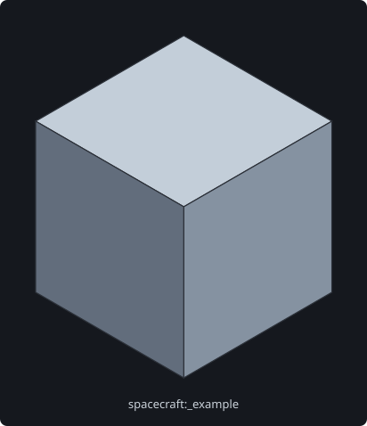

# 装備一覧

`spacecraft` に **装備**（防具・武器・ツール・アクセサリ・Curios スロット品）を追加したときに更新する一覧です。
共通の手順・命名規則は [`一覧の使い方.md`](../一覧の使い方.md) にあります。

## 使い方（装備を 1 つ追加したら）

1. [`_template.md`](_template.md) を `<id>.md` にコピーします（例 `space_helmet.md`）。
2. `<...>` をすべて埋め、**「使い方」をすべて書きます**。
3. **`models/<id>.json`** を作ります（`_example_model.json` が見本です）。
4. その JSON などから組み立てた画像と、ゲーム内撮影の画像を `images/` に置きます:
   - `<id>_held.png` … **手に持った状態**（JSON モデル由来）
   - `<id>_inventory.png` … **インベントリ内の状態**
   - `<id>_equipped.png` … **装備した状態**
   - `<id>_3d.png` … モデルの 3D 画像（任意）
5. md から JSON へリンクし、画像コメントを外して表示されるようにします。
6. 下の表に 1 行追加します。
7. **ビルドは不要**です。この一覧の変更は CI にも jar にも影響しません。

> `ここに追加` はユーザーさんが作ったプレースホルダです。残してください。

## 登録装備

| id | 名前 | スロット | md | 状態 |
| --- | --- | --- | --- | --- |
| — | — | — | — | まだ登録されていません（空の mod のため） |

## 画像の置き場所

```
装備一覧/
├── README.md              ← このファイル
├── _template.md           ← コピーして使う雛形
├── _example_model.json    ← モデル JSON の見本
├── ここに追加              ← プレースホルダ（残す）
├── <id>.md                ← 装備ごとの説明
├── models/<id>.json
└── images/
    ├── <id>_held.png
    ├── <id>_inventory.png
    ├── <id>_equipped.png
    └── <id>_3d.png
```

## 3D 画像の見本

[`_example_model.json`](_example_model.json) から `python3 tools/catalog.py render 装備一覧 x --example` で生成した画像です。`item/handheld` には `elements` が無いため既定の立方体を描いています（実装時は `models/<id>.json` に `elements` を足してください）。



## 3D 画像について

「json などを使用し組み立て」た手持ち・3D 画像は、`models/<id>.json` の `elements` と各面の `texture` を元にします。**元データの JSON を必ず残し、md からリンクしてください**。インベントリ内・装備時は開発用クライアントでのスクリーンショットを使います。

## 注意

- 実装していない装備の md は作らないでください。
- アイテムとしても登録されるため、[`アイテム一覧/`](../アイテム一覧/README.md) にも 1 行追加します。
- この `models/` は説明用の写しです。実際の JSON は `src/main/resources/assets/spacecraft/models/` に置きます。
